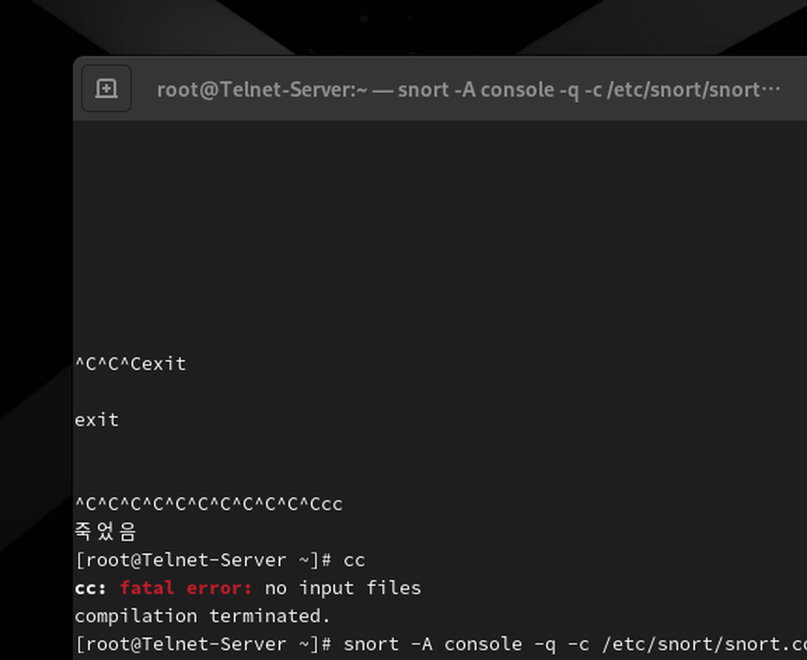
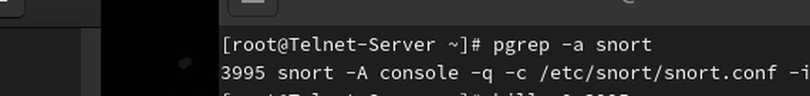
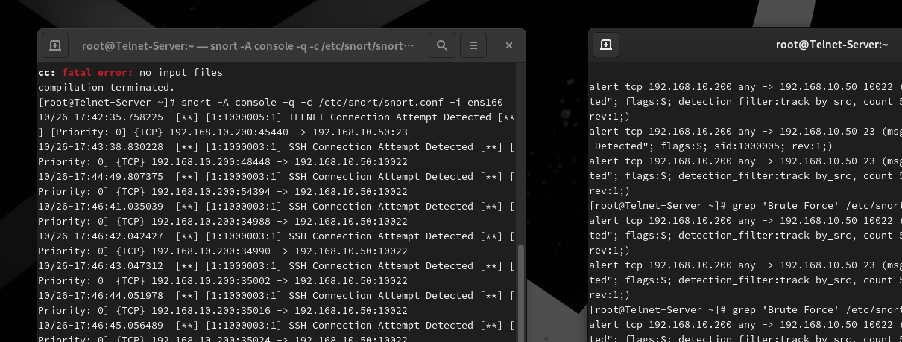

# Snort IDS — SSH·Telnet 접근 탐지 실습

## 1. 실습 개요

Rocky Linux 환경에서 Snort IDS를 이용해 네트워크 패킷을 감시하고, SSH 및 Telnet 서비스에 대한 접근 시도를 탐지하는 실습입니다.

직접 작성한 탐지 규칙을 기반으로 접속 이벤트와 반복 연결 경고를 확인하고, 탐지 결과를 보안관제 관점에서 분석했습니다.

## 2. 실습 환경

| 구분 | 환경 및 설정 | 역할 |
|---|---|---|
| 가상화 | VMware Workstation | 교육용 가상 네트워크 구축 |
| IDS 서버 | Rocky Linux 9.3 | Snort 실행 및 패킷 탐지 |
| 테스트 클라이언트 | Kali Linux | SSH·Telnet 연결 테스트 |
| IDS | Snort 2.9.20 | 사용자 정의 룰 기반 탐지 |
| 탐지 인터페이스 | ens160 | 네트워크 패킷 감시 |
| SSH 서비스 | 10022/TCP | SSH 접근 탐지 대상 |
| Telnet 서비스 | 23/TCP | Telnet 접근 탐지 대상 |

### 네트워크 구성

- **Rocky Linux:** `192.168.10.50`
- **Kali Linux:** `192.168.10.200`
- **탐지 규칙 경로:** `/etc/snort/rules/local.rules`
- **Snort 설정 파일:** `/etc/snort/snort.conf`

본 실습은 VMware 가상 네트워크에서 수행한 교육용 보안 실습입니다.

## 3. Snort 탐지 규칙 분석

### 3.1 사용자 정의 탐지 규칙

Snort의 사용자 정의 탐지 규칙은 `/etc/snort/rules/local.rules` 파일에서 관리했습니다.

실습에서 확인한 주요 탐지 규칙은 다음과 같습니다.

| SID | 탐지 메시지 | 탐지 목적 |
|---|---|---|
| 1000003 | SSH Connection Attempt Detected | SSH 연결 시도 탐지 |
| 1000004 | SSH Brute Force Suspected | SSH 반복 연결 의심 탐지 |
| 1000005 | TELNET Connection Attempt Detected | Telnet 연결 시도 탐지 |
| 1000006 | TELNET Brute Force Suspected | Telnet 반복 연결 의심 탐지 |

### 3.2 주요 탐지 옵션

- `alert`: 조건에 일치하는 패킷에 대해 경고 생성
- `tcp`: TCP 프로토콜 패킷 검사
- `flags:S`: TCP SYN 플래그를 기준으로 연결 시작 패킷 탐지
- `msg`: 탐지 시 출력할 경고 메시지
- `sid`: 탐지 규칙을 구분하는 고유 번호
- `rev`: 탐지 규칙의 개정 번호
- `detection_filter`: 지정한 시간 동안 규칙에 일치하는 이벤트 수 추적

### 3.3 반복 연결 탐지 조건

`detection_filter:track by_src, count 5, seconds 30;`

위 조건은 동일 출발지 IP를 기준으로 30초 동안 규칙에 일치하는 패킷 수를 추적하며, 지정한 기준에 도달하면 경고를 발생시키는 데 사용됩니다.

**분석 시 주의사항**

이번 실습의 반복 연결 규칙은 TCP SYN 패킷을 기준으로 동작하므로 실제 비밀번호 입력 횟수나 로그인 실패 횟수를 직접 검증하지 않습니다.

따라서 탐지 결과는 로그인 공격 성공이 아니라 **Brute Force 의심 이벤트**로 해석해야 합니다.

## 4. Snort 실행 및 탐지 결과

### 4.1 Snort 실행

Rocky Linux에서 다음 명령어를 사용해 Snort IDS를 실행했습니다.

```bash
snort -A console -q -c /etc/snort/snort.conf -i ens160
```

| 옵션 | 의미 |
|---|---|
| `-A console` | 탐지 경고를 터미널에 출력 |
| `-q` | 시작 시 불필요한 정보 출력 최소화 |
| `-c` | Snort 설정 파일 지정 |
| `-i` | 패킷을 감시할 네트워크 인터페이스 지정 |

설정 검증 과정에서 `Snort successfully validated the configuration!` 메시지를 확인했습니다.

### 4.2 SSH·Telnet 연결 시험

교육용 가상 네트워크에서 Kali Linux를 테스트 클라이언트로 사용했습니다.

Rocky Linux의 SSH 10022/TCP 및 Telnet 23/TCP 서비스에 대한 접근을 시도하고, Snort 콘솔에 탐지 이벤트가 출력되는지 확인했습니다.

### 4.3 탐지 결과 분석

실습에서는 SSH·Telnet 연결 시도에 대한 경고를 확인했습니다.

또한 반복 연결 조건에 해당하는 이벤트를 분석하면서 일반 접속 탐지와 반복 접근 의심 탐지의 차이를 학습했습니다.

**분석 시 주의사항**

Snort의 SYN 패킷 탐지는 연결 시도를 식별하는 기능입니다. 이것만으로 실제 로그인 실패 횟수나 계정 침해 성공 여부를 판단할 수는 없습니다.

따라서 `Brute Force Suspected` 메시지는 추가 분석이 필요한 의심 이벤트로 해석해야 합니다.

## 5. 트러블슈팅

### 5.1 문제 발생 — Snort 프로세스 종료 지연

Rocky Linux에서 Snort IDS를 실행한 후 종료하기 위해 `Ctrl+C`를 여러 번 입력했으나, 프로세스가 즉시 종료되지 않고 터미널 프롬프트가 돌아오지 않는 문제가 발생했습니다.

### 5.2 원인 분석 및 프로세스 확인

기존 터미널에서 정상적인 종료 여부를 확인하기 어려워 다른 터미널을 열고 실행 중인 Snort 프로세스를 조회했습니다.

```bash
pgrep -a snort
```

실습 당시 PID `3995`의 Snort 프로세스가 남아 있는 것을 확인했습니다.

`pgrep`는 실행 중인 프로세스를 이름으로 검색하며, `-a` 옵션을 사용하면 PID와 실행 명령어를 함께 확인할 수 있습니다.

### 5.3 해결 과정

프로세스에 일반 종료 신호를 전달했으나 종료되지 않아, 최종적으로 강제 종료를 수행했습니다.

```bash
kill 3995
kill -9 3995
```

- `kill 3995`: 프로세스에 일반 종료 신호(SIGTERM)를 전달
- `kill -9 3995`: 즉시 종료를 요청하는 SIGKILL 신호 전달

강제 종료 후 다시 `pgrep -a snort`를 실행했으며, 해당 프로세스가 더 이상 조회되지 않는 것을 확인했습니다.

**주의:** `kill -9`는 정상적인 정리 작업을 생략할 수 있으므로 일반 종료 방식이 실패했을 때 최후 수단으로 사용해야 합니다. PID는 실행할 때마다 달라지므로 실제 확인한 PID를 사용해야 합니다.

### 5.4 정상 동작 재검증

프로세스 종료 후 Snort IDS를 다시 실행했습니다.

```bash
snort -A console -q -c /etc/snort/snort.conf -i ens160
```

재실행 이후 SSH 및 Telnet 관련 탐지 경고가 정상적으로 출력되는 것을 확인했습니다.

이를 통해 프로세스를 종료하고 다시 실행한 이후에도 탐지 기능이 동작한다는 것을 검증했습니다.

### 5.5 분석 결과 및 배운 점

이번 문제의 정확한 원인은 파악하지 못했습니다. 종료 신호 처리 지연이나 터미널 상태 등이 가능성으로 남아 있고, 이를 원인으로 단정할 근거는 확보하지 못했습니다.

이번 실습을 통해 다음 사항을 배우게 됐습니다.

- 프로세스가 종료되지 않을 경우 PID와 실제 실행 상태를 확인해야 합니다.
- 일반 종료와 강제 종료의 차이를 이해해야 합니다.
- 문제 해결 후 서비스를 재실행하고 기능을 다시 검증하는 과정이 중요합니다.
- 추정한 원인과 실제 확인된 결과를 구분해 기록해야 합니다.


### 5.6 실제 트러블슈팅 증거 화면

**① Snort 종료 지연 화면**



**② 실행 중인 프로세스 확인**


**③ 프로세스 종료 및 상태 확인**



**④ 재실행 후 탐지 결과 검증**


  
